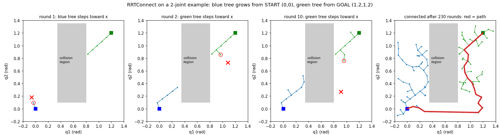
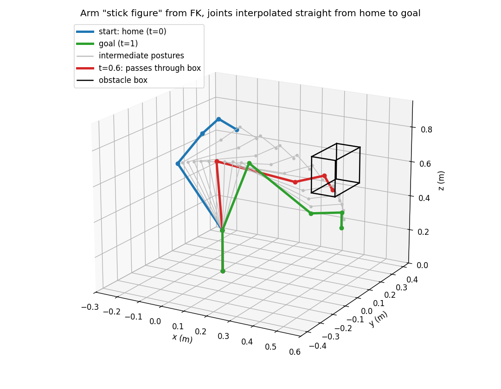

# 10 M3 第 1 步:规划场景 + 位姿目标,让机械臂绕开障碍物

> M3(11 月初):*Basic motion planning in simulation.* 在 MoveIt 2 中配置机器人;生成从初始构型到目标位姿的无碰撞运动;理解哪些是 MoveIt 自动求解的、哪些是自己提供的约束;在仿真中演示一个简单的抓取放置。
>
> 本篇是 M3 的第 1 步:**在规划场景里放桌子和障碍物,用"位姿目标"让 MoveIt 自己做 IK、避障、规划并执行。** 这一步不依赖夹爪,所以先做。

## 1. M3 的整体安排

| 步骤 | 内容 | 依赖 |
|---|---|---|
| **第 1 步(本篇)** | 规划场景加桌子和障碍物 + 位姿目标,验证路径绕开障碍物 | 无 |
| 第 2 步 | 接入夹爪(总 xacro,MoveIt 和 Gazebo 共用)、`tool_tip`、SRDF 的 `gripper` 组与末端执行器 | 先确认夹爪型号 |
| 第 3 步 | 笛卡尔直线靠近 / 抬起,串成抓取放置流程 | 第 1、2 步 |
| 第 4 步 | "MoveIt 自动做什么 vs 我提供什么"文档、演示视频、M3 总结 | 全部 |

在 WARA 团队里,抓取位姿由 Grasp Planning 提供(团队计划用 VLA 模型识别物体并输出抓取位姿),我负责拿到位姿之后的运动:靠近、抬起、搬运、放置、避障、笛卡尔控制。M3 仿真里没有这部分输入,先自己设一个简单的目标位姿作为替代。

## 2. 关节目标 vs 位姿目标

| | 之前(`my_move_group_client.py`) | 现在(本篇脚本) |
|---|---|---|
| 发给 `/move_action` 的是 | 6 个关节角(`JointConstraint`) | Link6 的位置 + 姿态(`PositionConstraint` + `OrientationConstraint`) |
| IK 谁做 | 自己在外面算 | MoveIt 在规划过程中自己做 |
| 是否结合碰撞挑选 IK 解 | 否,解是固定的 | 是,某个解会撞就换另一个 |

注意:**Gazebo 不做规划,只负责执行**;规划永远是 MoveIt 做的。

## 3. MoveIt 收到位姿目标后做了什么

1. **求目标关节角(IK)**:用 KDL(基于 Jacobian 的数值迭代,与 M2 自己写的阻尼最小二乘同一类方法)求出能让 Link6 到达目标位姿的关节角,通常有多个候选。
2. **过滤**:去掉撞到桌子、障碍物或机器人自身的候选,以及超出关节限位的。剩下的作为"目标状态"。
3. **找路径(OMPL 的 RRTConnect)**:在关节空间里从当前状态和目标状态各长一棵树,直到连上(见第 4 节)。每个采样姿态、每段连线都用 **FCL** 做碰撞检查。
4. **简化路径**:去掉多余拐弯。
5. **时间参数化**:给路径上每个点加上时间、速度、加速度,保证不超过上限;脚本里速度、加速度都按上限的 30% 缩放。(Dobot 的 `joint_limits.yaml` 目前没打开速度/加速度限制,M4 要补上。)
6. **执行**:通过 `FollowJointTrajectory` Action 发给 `nova5_group_controller`,控制器以 100 Hz 插值,Gazebo 里的机械臂动起来。

## 4. RRTConnect 是怎么找路径的



图中横轴、纵轴是两个关节角,**每一个点代表一个姿态**;灰色区域是会碰撞的姿态(实际规划时事先不知道,只能逐点检查)。蓝色方块是起点,绿色方块是目标。

每一轮:

1. **随机选一个姿态**(红色 ×),它只是方向参考;
2. 一棵树从离 × 最近的节点出发,**朝 × 走一小步**(固定步长),这一小段不撞就加入树(红圈);
3. 另一棵树朝这个新节点**直线、一步一步地走**,每步检查碰撞:碰到新节点 → 两棵树连上,路径找到;下一步会撞 → 停下,已走过的保留;
4. 交换两棵树的角色,重复。

**为什么这样做**:

- "直线去够"负责**快**:路好走时一两轮就连上;
- "随机走一步"负责**绕**:让树往各个方向伸展,总有分支能从障碍旁边绕过去;
- 不用网格搜索,是因为 6 个关节每个分 100 格就是 100⁶ = 一万亿格;不先算禁区形状,是因为 6 维里算不出来;随机采样只需要回答"这个姿态撞不撞"(FK + FCL),维度再高也能工作。

**代价**:路径不是最短且弯曲(需要简化);每次结果不同;超时只能说明没找到,不能证明没有路;但只要路径存在、时间足够,找到的概率趋近于 1(概率完备)。

## 5. 障碍物位置是怎么选的

目标:设计一个"不绕路就一定会撞"的障碍物,满足三个条件:起点碰不到、终点碰不到、但关节"直线"插值的中途会撞上。

做法(用 M2 的 FK):

1. 起点 = home;终点 = 用自己的 `ik_all` 求出目标位姿的 8 组解中离 home 最近的一组 `(0.61, −0.267, −2.107, 0.803, 1.571, −0.96)`;
2. 用 `joint_transforms(q)` 算出每个关节原点在空间中的位置,依次连起来得到手臂的"火柴人";
3. 关节从起点匀速插值到终点 `q(t) = q_起点 + t·(q_终点 − q_起点)`,每个 t 都画一个火柴人;
4. 在空间里每隔 5 cm 试一个方块位置,保留"到起点、终点火柴人距离 > 0.12 m,但与中间某帧相交"的位置。

结果:中心 (0.50, 0, 0.70) m、尺寸 0.10 × 0.20 × 0.20 m。到各帧火柴人的距离:

| t | 0 | 0.1 | 0.2 | 0.3 | 0.4 | 0.5 | **0.6** | 0.7 | 0.8 | 0.9 | 1.0 |
|---|---|---|---|---|---|---|---|---|---|---|---|
| 距离(m) | 0.33 | 0.24 | 0.16 | 0.10 | 0.05 | 0.01 | **0** | 0.02 | 0.09 | 0.15 | 0.22 |



蓝 = 起点 home,绿 = 目标,灰 = 中间姿态,红 = t = 0.6 时穿过方块。

说明:火柴人只是中心线,真实连杆有粗细,所以起点、终点留了 > 0.12 m 余量;MoveIt 实际选的 IK 解可能不是这一组,那样方块不一定挡路——这也是实验要观察的。

## 6. 代码说明(`m3_step1_pose_goal_obstacles.py`)

| 位置 | 函数 | 做什么 |
|---|---|---|
| 常量 | `DEFAULT_TARGET`、`DOWN_QUAT`、`TABLE`、`OBSTACLE` | 目标位置 (0.45, 0.15, 0.30) m;朝下的四元数;桌子和障碍物 |
| ① | `apply_objects` | 通过服务 `/apply_planning_scene` 把碰撞体加进(或移出)规划场景 |
| ② | `pose_goal` / `joint_goal` | 位姿目标 / 关节目标 |
| ③ | `plan_and_execute` | 发给 `/move_action`,等结果 |
| ④ | `ee_pose_from_tf` | 执行后从 TF 读 Link6 实际位姿 |
| | `summarize` | 打印规划耗时、轨迹点数与时长、关节空间路径长度、MoveIt 选中的 IK 解 |
| | `compare_with_own_ik` | 用 M2 的 `ik_all` 求同一目标的所有解,标出和 MoveIt 相同的那组 |
| | `main` | 按 ①→②→③→④ 调用;命令行参数控制有无障碍物、只规划、回 home、清场景 |

### 6.1 ① 规划场景

```python
scene = PlanningScene()
scene.is_diff = True                       # 增量修改,不替换整个场景
co = CollisionObject()
co.header.frame_id = "base_link"           # 位置以 base_link 为参照
co.id = "obstacle"
co.pose = make_pose((0, 0, 0))             # 物体坐标系 = base_link
box = SolidPrimitive(); box.type = SolidPrimitive.BOX
box.dimensions = [0.10, 0.20, 0.20]        # 长 宽 高(m)
co.primitives = [box]
co.primitive_poses = [make_pose((0.50, 0.00, 0.70))]   # 方块中心
co.operation = CollisionObject.ADD         # 移除时用 REMOVE
scene.world.collision_objects.append(co)
# 调用服务 /apply_planning_scene(moveit_msgs/srv/ApplyPlanningScene)
```

- **桌面比底座低 3 cm**:若桌面正好在 z = 0,底座外形会和桌面重叠,MoveIt 判定起始状态"碰撞"(*start state in collision*)而拒绝规划。另一种做法是贴着放,再在允许碰撞列表里声明 `base_link` 与桌子不检查。
- **只加在 MoveIt 里**:Gazebo 里看不到这些物体(MoveIt 和 Gazebo 是两个独立的世界)。RViz 的 Scene Objects 面板也能手动添加,但不可重复;正式演示用代码。

### 6.2 ② 位姿目标

```python
pc = PositionConstraint()                  # Link6 原点要落在半径 5 mm 的小球里
pc.header.frame_id = "base_link"; pc.link_name = "Link6"
sphere = SolidPrimitive(); sphere.type = SolidPrimitive.SPHERE; sphere.dimensions = [0.005]
pc.constraint_region.primitives = [sphere]
pc.constraint_region.primitive_poses = [make_pose(target_xyz)]

oc = OrientationConstraint()               # 姿态与目标的偏差,绕三轴都不超过 0.01 rad
oc.header.frame_id = "base_link"; oc.link_name = "Link6"
oc.orientation = 四元数 (1, 0, 0, 0)
oc.absolute_x_axis_tolerance = oc.absolute_y_axis_tolerance = oc.absolute_z_axis_tolerance = 0.01
```

(精简写法,完整代码见脚本。)

**朝下的四元数 `(1, 0, 0, 0)`**:四元数 `(x, y, z, w) = (sin(θ/2)·a, cos(θ/2))`。`w = 0` → θ = 180°;于是 `sin(θ/2) = 1`,`(x, y, z)` 就是转轴 `(1, 0, 0)`。即"绕 x 轴转 180°",旋转矩阵 `diag(1, −1, −1)`,第 3 列 `(0, 0, −1)`:Link6 的 z 轴竖直朝下。

### 6.3 ③ 规划与执行

```python
req = MotionPlanRequest()
req.group_name = "nova5_group"
req.num_planning_attempts = 10
req.allowed_planning_time = 10.0           # 超时 → PLANNING_FAILED
req.max_velocity_scaling_factor = 0.3      # 速度上限的 30%
req.max_acceleration_scaling_factor = 0.3
req.start_state.is_diff = True             # 从当前状态出发
req.goal_constraints = [位姿目标]
opts = PlanningOptions(); opts.plan_only = False   # --plan-only 时为 True
```

执行阶段,MoveIt 按 `moveit_controllers.yaml` 找到控制器:

```yaml
nova5_group_controller:
  type: FollowJointTrajectory              # 通信接口:用哪种 Action
  action_ns: follow_joint_trajectory
```

控制器本身由 `ros2_controllers.yaml` 声明:

```yaml
nova5_group_controller:
  type: joint_trajectory_controller/JointTrajectoryController   # 控制器是什么(用哪个类)
```

两个 `type` 含义不同:前者是**通信接口**,后者是**控制器的实现类**。控制器激活后提供 Action 服务端 `/nova5_group_controller/follow_joint_trajectory`,MoveIt 作为客户端把带时间的 `JointTrajectory` 发过去。可用 `ros2 interface show control_msgs/action/FollowJointTrajectory` 查看消息结构。(`send_trajectory_direct.py` 演示了绕过 MoveIt 直接发轨迹给控制器——没有规划和碰撞检查,仅用于仿真理解。)

### 6.4 ④ 检查

- **TF**:`robot_state_publisher`(ROS 2 标准包)根据 URDF 和 `/joint_states` 发布相邻连杆之间的变换(会动的发到 `/tf`,固定的只发一次到 `/tf_static`);`tf2` 查询 `base_link → Link6` 时自动连乘。
- **只比较最终位姿**(执行完等 2 秒停稳后读一次),不是每个时间点。逐点比较"计划 vs 实际"是 M4 的内容。
- **位置误差** `‖p − p_目标‖`(mm)。
- **姿态误差** `θ = 2·arccos(|q · q_目标|)`:两个单位四元数的点积等于 cos(θ/2);取绝对值是因为 q 与 −q 表示同一旋转。与 M2 用 `R₁ᵀR₂` 的旋转向量长度算出的是同一个角度。
- 预期:位置差几 mm 以内(目标本身允许 5 mm、0.01 rad 的容差,加上控制器跟踪误差)。

## 7. 运行

三个终端,都先 `./start_dobot.sh` 进入容器:

```bash
# 终端 1:Gazebo(仿真世界 + 控制器)
export DOBOT_TYPE=nova5
ros2 launch dobot_gazebo gazebo_moveit.launch.py

# 终端 2:MoveIt(move_group + RViz)
ros2 launch dobot_moveit moveit_gazebo.launch.py

# 终端 3:脚本(同目录放 nova5_model.py、nova5_kinematics.py,用于 IK 对照)
cd /dobot_ws/shared
python3 m3_step1_pose_goal_obstacles.py --no-obstacle   # ① 只有桌子
python3 m3_step1_pose_goal_obstacles.py --home          # ② 回 home
python3 m3_step1_pose_goal_obstacles.py                 # ③ 桌子 + 障碍物
python3 m3_step1_pose_goal_obstacles.py --home          # ④ 回 home
python3 m3_step1_pose_goal_obstacles.py --clear         # ⑤ 清掉场景物体
```

只想在 RViz 里看:终端 1、2 换成 `ros2 launch dobot_moveit moveit_demo.launch.py`。

**要观察的**:

- RViz:桌子、障碍物显示为绿色方块;第 ③ 次手臂应绕开方块(MotionPlanning → Planned Path → Show Trail 可看路径残影);
- 终端:比较 ① 与 ③ 的"关节空间路径长度"比值,有障碍物时应更大;
- Gazebo:手臂会动,但看不到场景物体;
- IK 对照:MoveIt 选的是自己找到的哪一组解,有无障碍物时是否不同。

**可能的问题**:*start state in collision* → 把 `TABLE` 的 z 再调低;`error_code = -1` → 再运行一次(RRTConnect 是随机的)或加大 `allowed_planning_time`。

## 8. 结果

<!-- 运行后填写:①③ 两次的规划耗时、轨迹时长、路径长度比值、MoveIt 选中的 IK 解、执行后位置/姿态误差,附 RViz 截图 -->

(待运行后填写)

## 9. 下一步

- 我先逐段阅读、理解脚本,再运行并填写第 8 节结果;
- 确认夹爪型号(实验室 Nova 5 上的 Robotiq 型号,还是 WARA 用的 SCHUNK EGU 60),进入第 2 步;
- 待办:逐行阅读启动链路(`dobot_moveit/launch/moveit_gazebo.launch.py` → `nova5_moveit/launch/moveit_gazebo.launch.py`)。
